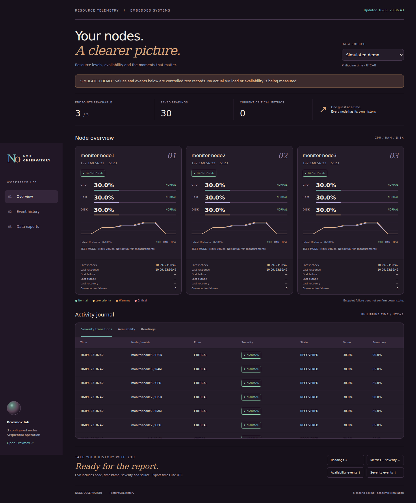

# The SIS

### Proxmox Resource Monitoring Console

<p align="center">
  
</p>

The SIS is a local web dashboard for monitoring Proxmox lab resources. It collects CPU, RAM, disk, and availability readings from configured nodes, stores monitoring history in PostgreSQL, and presents live status, events, threshold alerts, and downloadable reports in one console.

> This repository includes a simulated dashboard preview. It does not show live production infrastructure.

## What it monitors

- Resource utilization: CPU, RAM, and disk usage per node.
- Endpoint availability and failed-check history.
- Warning and critical threshold transitions.
- Timestamped activity history stored in PostgreSQL.
- CSV exports for readings, metrics, availability events, and severity events.

## Dashboard capabilities

- A node overview with current utilization, trend charts, reachability, and recent status details.
- An activity journal for severity transitions, availability events, and recent readings.
- Configurable low, warning, and critical thresholds.
- In-dashboard warning and critical alert popups with optional repeating audio.
- A notification panel and local dashboard controls.
- A separate monitoring agent for collecting data from the Proxmox environment.

## Technology stack

- Python
- Flask
- Waitress
- PostgreSQL
- `psycopg`
- Proxmox API polling with `requests`
- HTML, CSS, and JavaScript

## Project structure

```text
app.py / viewer.py      Flask dashboard application
logger.py               Monitoring and data-logging process
agent/                  Node monitoring agent and service definition
templates/              Dashboard HTML template
static/                 CSS, JavaScript, audio, and image assets
examples/               Safe simulated CSV inputs
preview-simulated.png   Dashboard preview shown above
```

## Run locally

1. Create and activate a Python virtual environment.
2. Install dependencies:

   ```bash
   pip install -r requirements.txt
   ```

3. Create your local `.env` configuration with the required Proxmox and database settings. Do not commit this file.
4. Set up the PostgreSQL history database using the included guides and SQL checks.
5. Start the monitoring logger:

   ```bash
   python logger.py
   ```

6. Start the dashboard:

   ```bash
   python viewer.py
   ```

7. Open `http://127.0.0.1:5124` in your browser.

## Documentation

- [Demo guide](./DEMO_GUIDE.md)
- [Requirements checklist](./REQUIREMENTS_CHECKLIST.md)
- [Threshold settings](./THRESHOLD_SETTINGS.md)
- [PostgreSQL guide](./PGADMIN_GUIDE.md)
- [Validation notes](./VALIDATION.md)

## Data and security

The repository intentionally excludes local `.env` files, virtual environments, databases, monitoring logs, CSV history, and backups. Use the included simulated examples for safe demonstrations, and keep Proxmox credentials and production telemetry private.

---

Built as an academic Proxmox monitoring project by [Louise Catala](https://github.com/LouiseCatala).
